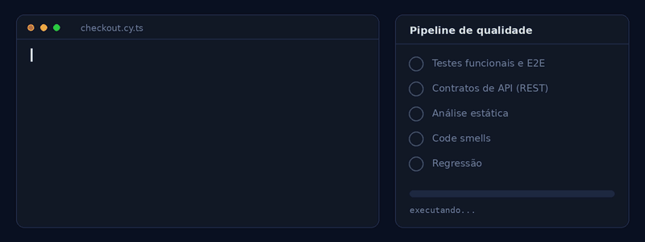
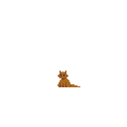

<h1 align="center">Diogo Mascarenhas</h1>

<p align="center">
  Desenvolvedor Full Stack Júnior · QA · Pesquisa em Engenharia de Software<br/>
  <sub>Manutenção e evolução de software · Dívida técnica · Qualidade orientada a métricas</sub>
</p>

<p align="center">
  <a href="https://www.linkedin.com/in/diogomasc">LinkedIn</a> ·
  <a href="mailto:diogomascarenhas0574@gmail.com">E-mail</a> ·
  <a href="http://lattes.cnpq.br/2102198906146333">Lattes</a>
</p>

---

## 🌿 Linhas de pesquisa

```console
$ git branch --list "research/*"
* research/manutencao-e-evolucao-de-software
  research/divida-tecnica
  research/code-smells-e-analise-estatica
  research/qualidade-orientada-a-metricas
```

| Linha | O que me interessa |
| --- | --- |
| **Manutenção e evolução de software** | Como o código muda ao longo do tempo e o que mantém um sistema sustentável de evoluir. |
| **Dívida técnica e degradação de software** | Prevenção e mitigação da dívida técnica estrutural, e a relação entre a estrutura do código e o comportamento dinâmico (desempenho sob carga). |
| **Code smells e análise estática** | Detecção e mitigação de code smells por análise estática, com foco em código manutenível e evolutivo. |
| **Qualidade orientada a métricas** | Medição e observação de atributos de qualidade com ISO/IEC 25010 e ISO/IEC/IEEE 15939, além de testes de carga. |

Bacharel em Sistemas de Informação no **IFBA** e discente não-regular do **Mestrado Profissional em Engenharia de Sistemas e Produtos** (IFBA, Salvador).

---

## ✅ Qualidade antes e depois do código

QA, para mim, segue o ciclo de vida de testes (STLC), com cada técnica na fase em que entrega mais valor. Nos requisitos, testes **estáticos** (revisão de requisitos, análise estática e code smells) previnem defeitos antes de o código existir. No projeto de testes, uso **partição de equivalência** e **análise de valor limite** para cobrir casos de borda. Na execução, testes **dinâmicos** nos níveis de unidade (Jest, Vitest, JUnit), integração e API (Postman, Bruno) e sistema (Cypress). No fechamento, a **regressão** protege o que já funciona. O estático previne e o dinâmico detecta; os dois se complementam. Também me interessa a diferença entre o papel de desenvolvimento e o de QA, e entre entregas **eficazes** (resolvem o problema certo) e **eficientes** (resolvem com menor custo de tempo e recurso).

<p align="center">
  
</p>

## 🔬 Deep Learning no NuFuturo (Nubank/IFBA)

Pesquiso e implemento modelos de detecção de fraudes em transações financeiras com **Python**, **PyTorch**, **Graph Neural Networks** e **Variational Autoencoders**. A validação de hipóteses e a leitura crítica de resultados voltam para o meu trabalho em QA e em engenharia de software.

---

## 🕒 Trajetória

```console
$ git log --oneline --graph
* 4f2a9c1 (HEAD -> main) 2026 NuFuturo (Nubank/IFBA): detecção de fraudes com GNN e VAE
* 9b7e3d0 2026 Mestrado Profissional (IFBA) como aluno não regular
* c81a5e7 2026 Bootcamp de QA (Atlântico Avanti), nota 9,7
* 3d6f0b2 2025 CEPEDI: front-end Next.js/React e QA na plataforma RH de Favela
* a05c4e8 2024 CEPEDI: full stack com React Native e Node.js
* 7e19d44 2022 SEDUC-BA: dados do EducaCenso e Sistema Presença, SQL Server
* 1c0ffee 2021 IFBA: início do Bacharelado em Sistemas de Informação
```

---

## 🛠️ Stack

<details>
<summary>Lista completa</summary>

- **Front-end e mobile:** TypeScript, JavaScript (ES6+), React, Next.js (SSR, SSG), React Native, HTML5, CSS3, Tailwind CSS, React Query, React Hook Form, Zod, Formik, Yup, Axios, Vite, Custom Hooks, WCAG (Princípios POUR), heurísticas de Nielsen, Figma
- **Back-end e APIs:** Node.js, Express, NestJS, Fastify, Java, Spring Boot, Spring Security, REST APIs, Validação de Contratos, JWT, OAuth, RBAC.
- **Bancos de dados:** PostgreSQL, MySQL, SQLite, SQL Server, MongoDB, Redis, Prisma, Drizzle ORM, Sequelize
- **Qualidade e testes:** Cypress (Custom Commands), Postman, Bruno, K6, Swagger UI, Supertest, Jest, Vitest, JUnit,Testes Funcionais, Exploratórios, de Regressão, de Integração, de API e E2E, Critérios de Aceite, Relatório de Bugs, ISO/IEC 25010, ISO/IEC/IEEE 15939, SDLC, STLC
- **Qualidade de código e manutenção:** Análise estática, Code Smells, Dívida Técnica, Métricas de Qualidade
- **Práticas de desenvolvimento:** SOLID, Design Patterns, POO, DDD, Arquitetura MVC e em Camadas, UML, TDD, BDD, Scrum, Kanban
- **Infra e DevOps:** Docker, Git, GitHub, CI/CD

</details>

---
  
```console
$ git commit -m "refactor: menos dívida técnica, mais código que evolui"
[main 8a3f1d2] refactor: menos dívida técnica, mais código que evolui
```

<p align="right">
  
</p>